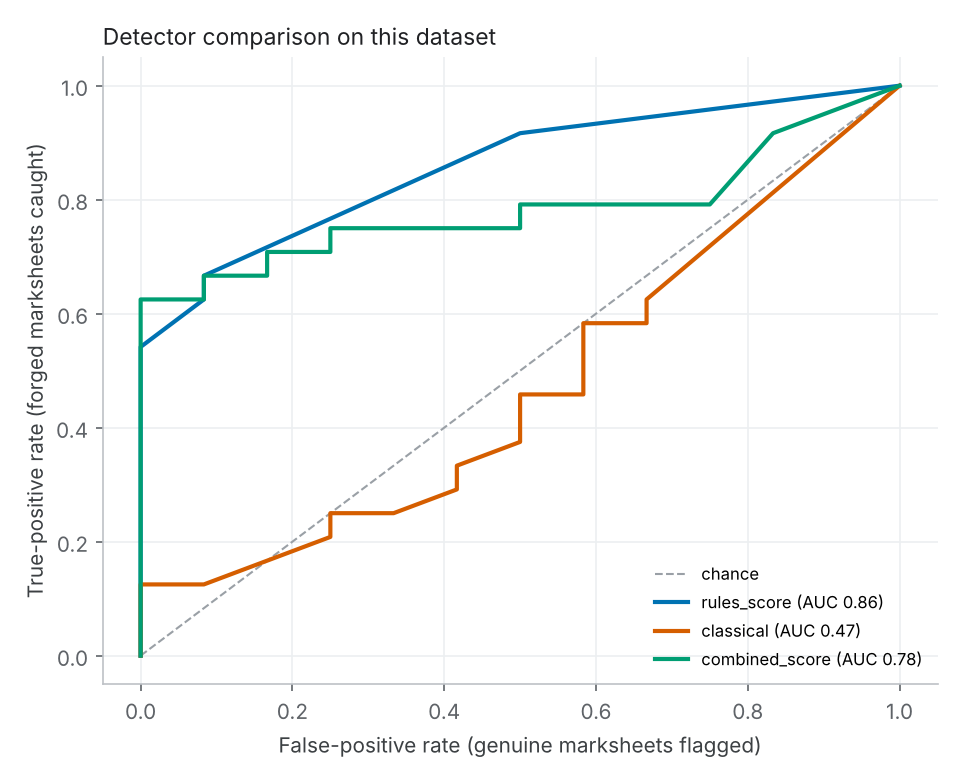

# Marksheet forensics evaluation

Files analysed: 36 (24 forged, 12 genuine).

> Read this carefully: on synthetic data these numbers show that the harness works, NOT how good a detector is on real Kerala marksheets. The synthetic forgeries are proxies. Add real AI-edited samples before drawing conclusions.

## Overall (AUC and true-positive rate at a fixed false-positive rate)

| score | auc | tpr@fpr5% | tpr@fpr1% | n_forged | n_genuine |
|---|---|---|---|---|---|
| rules_score | 0.858 | 0.542 | 0.542 | 24 | 12 |
| det_classical | 0.469 | 0.125 | 0.125 | 24 | 12 |
| combined_score | 0.783 | 0.625 | 0.625 | 24 | 12 |

## AUC by forgery type (each type vs all genuine files)

| scope | combined_score | det_classical | rules_score |
|---|---|---|---|
| copy_move | 0.979 | 0.500 | 0.969 |
| edit_consistent | 0.385 | 0.312 | 0.594 |
| edit_inconsistent | 1.000 | 0.500 | 0.990 |
| inpaint_sim | 0.333 | 0.312 | 0.594 |
| name_swap | 1.000 | 0.479 | 1.000 |
| pdf_text_edit | 1.000 | 0.708 | 1.000 |

## Routing at current thresholds (review >= 0.35, high >= 0.7)

Genuine files sent to a human (false-alarm rate) by capture type:

| carrier | share_flagged | n |
|---|---|---|
| pdf_clean | 0.000 | 4 |
| phone | 0.000 | 4 |
| scan | 0.000 | 4 |

Forged files sent to a human (catch rate) by forgery type:

| edit_type | share_flagged | n |
|---|---|---|
| copy_move | 0.500 | 4 |
| edit_consistent | 0.000 | 4 |
| edit_inconsistent | 0.750 | 4 |
| inpaint_sim | 0.000 | 4 |
| name_swap | 1.000 | 4 |
| pdf_text_edit | 1.000 | 4 |

## Detectors that did not run

- **community_forensics**: torch/transformers not installed (ModuleNotFoundError); run setup.sh
- **sdxl_detector**: torch/transformers not installed (ModuleNotFoundError); run setup.sh
- **trufor**: TruFor repo not found at /home/claude/marksheet-forensics/third_party/TruFor; run setup.sh
- **seed**: SEED repo not found at /home/claude/marksheet-forensics/third_party/SEED (clone the GitHub repo linked from the model card)

